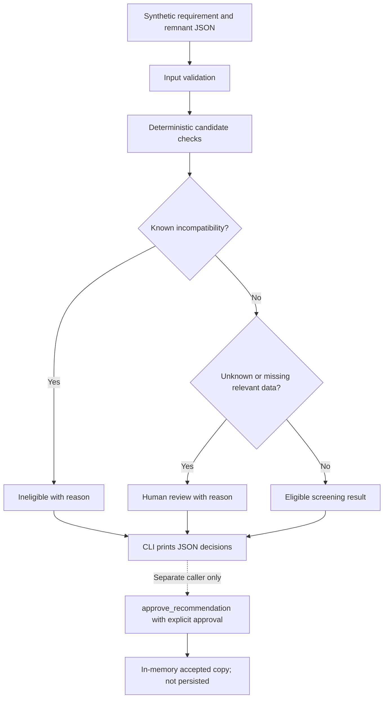

# Material Yield & Reuse Diagnostic

*A synthetic-data decision-support prototype supporting a structural steel fabrication FDE case study.*

> **SYNTHETIC DEMONSTRATION DATA — NOT CLIENT DATA**
>
> The checked-in records are fabricated examples created only to exercise prototype logic. They were authored for this repository; they are not extracted from ERP, STRUMIS, PLM, nesting software, discovery notes, or operational records. They do not describe real inventory, nesting performance, or savings.

## At a glance

| | Status |
|---|---|
| **Business problem** | Determine whether material waste and remnant reuse present a measurable workflow opportunity before choosing a software intervention. |
| **Prototype purpose** | Demonstrate transparent, deterministic screening of synthetic remnant candidates against one material requirement. |
| **Implementation** | Local Python CLI and decision functions; no service, database, or integration. |
| **Data** | Synthetic and hand-authored; no confidential client information. |
| **Key limitation** | Illustrative checks do not establish engineering suitability and must not drive real material decisions. |

## Why this project exists

The case framing supplied for this assessment says the anonymous client expressed interest in AI-powered nesting optimisation. Discovery also identified possible themes involving material yield and waste, reusable remnants, drawing revisions, project allocation, yard accessibility, and existing STRUMIS capabilities. These are **user-provided case context**, not independently verified operational findings. The client remains anonymous.

An interest in an optimizer does not establish that nesting is the main source of loss, that records are reliable, or that new software is needed. The recommended first engagement is a **four-week, read-only Material Yield & Reuse Diagnostic** to map decisions, assess approved evidence, validate candidate causes, and recommend whether to configure, change process, pilot, or stop. The diagnostic has not been conducted.

**Measure first → Validate the opportunity → Pilot if justified → Scale only with evidence.**

## What the prototype actually does

The CLI loads one JSON requirement and a list of candidate remnants. It validates the request envelope and requirement fields, applies deterministic checks for grade, thickness, rectangular dimensions, stated availability, transfer permission, project identity where needed, and certification status, then prints each candidate's status and reasons.

- Known incompatibility or a known restriction produces `ineligible`.
- Missing or unknown relevant attributes produce `human_review` unless a known incompatibility already rejects the candidate.
- Passing the demonstration checks produces `eligible`, still with `accepted: false`.
- `approve_recommendation()` requires `human_approved=True` for an eligible result. This is an in-memory function only: the CLI does not call it, capture a person's identity, or persist approval.

There is **no ranking, AI/LLM decision, nesting optimization, or production workflow** in this code.

## Implemented flow



## Example walkthrough

The checked-in case requires grade `S355`, thickness `12 mm`, and a `1200 × 500 mm` rectangular blank for `SYN-PROJECT-A`. These are invented demonstration values, not client data. Run the command below to reproduce the output.

| Candidate | Synthetic example | Result | Reason |
|---|---|---|---|
| `SYN-REM-001` | S355, 12 mm, 1300 × 600 mm, available, same project, certification marked verified | `eligible` | All implemented checks pass; still not accepted. |
| `SYN-REM-002` | S275, otherwise sufficient and transfer marked allowed | `ineligible` | Grade mismatch. |
| `SYN-REM-003` | S355, 12 mm, 900 × 400 mm | `ineligible` | Insufficient dimensions. |
| `SYN-REM-004` | Otherwise sufficient, marked unavailable | `ineligible` | Unavailable. |
| `SYN-REM-005` | Otherwise sufficient, transfer marked restricted | `ineligible` | Transfer restricted. |
| `SYN-REM-006` | S355, 12 mm, sufficient dimensions, transfer and certification unknown | `human_review` | Unknown permissions and unverified traceability are not approved. |

`verified`, `available`, and transfer values in this fixture are fabricated input assertions. The code does not verify the underlying fact or certificate. See the [synthetic data guide](docs/04-synthetic-data-guide.md) and [system design](docs/05-system-design.md).

## Repository map

| Path | Purpose |
|---|---|
| [`case-study/`](case-study/README.md) | Anonymized case framing and evidence labels. |
| [`analysis/assumptions-register.md`](analysis/assumptions-register.md) | Assumptions and hypotheses to validate. |
| [`docs/`](docs/01-project-overview.md) | Project overview, workflow, diagnostic, data, design, and evaluation documentation. |
| [`prototype/src/`](prototype/src/) | Input validation, deterministic rules, and CLI. |
| [`prototype/data/example_case.json`](prototype/data/example_case.json) | One fully synthetic requirement with six illustrative candidates. |
| [`prototype/tests/`](prototype/tests/) | Unit and CLI smoke tests for implemented rules and approval boundary. |
| [`reports/sample-run.md`](reports/sample-run.md) | Reproducible run notes and observed output summary. |
| [`AI_USAGE.md`](AI_USAGE.md) | AI assistance and review disclosure. |

## Reproducible end-to-end demonstration

Requires Python 3.9+ and no third-party packages. Run from the repository root:

```bash
cd prototype
python3 -m src.evaluate data/example_case.json
python3 -m unittest discover -s tests -v
```

The first command is the smallest end-to-end workflow: it reads the fabricated requirement and remnant records, validates them, applies the deterministic screening rules, and prints one explained decision per candidate. The second command runs the same rule tests plus a CLI smoke test against that fixture.

Expected test result: **14 tests pass** in the current checked-in suite. The [evaluation document](docs/06-evaluation-and-limitations.md) explains what that does and does not establish.

## Limitations and non-goals

- Synthetic data only; no client data, live STRUMIS connection, or client savings claim.
- No AI-powered or industrial nesting optimization.
- No cutting plan, kerf, geometry, defect, tolerance, or engineering suitability checks.
- No certificate verification, authoritative stock/transfer lookup, reservation, audit log, identity, or persisted approval.
- No autonomous purchasing, allocation, cutting, or production decision.
- No claim that the diagnostic has run or established the cause of material loss.

The prototype is an interview demonstration, not production-ready software. See [evaluation and limitations](docs/06-evaluation-and-limitations.md).

## What would be required next?

Only after the diagnostic identifies a bounded opportunity: client-approved data definitions and access; qualified engineering and quality validation of compatibility rules; authoritative inventory, traceability, and transfer controls; security and retention design; integration discovery for existing tools such as STRUMIS; a named workflow owner; and a controlled pilot with baseline, success criteria, exception handling, manual fallback, and stop conditions.

## AI usage and ownership

AI assistance in drafting and coding is disclosed in [`AI_USAGE.md`](AI_USAGE.md). The repository author remains responsible for review and for obtaining qualified domain validation. No AI model makes technical compatibility decisions.

## Further reading

- [Project overview](docs/01-project-overview.md)
- [Problem and process](docs/02-problem-and-process.md)
- [Proposed diagnostic methodology](docs/03-diagnostic-methodology.md)
- [Synthetic data guide](docs/04-synthetic-data-guide.md)
- [System design and decision rules](docs/05-system-design.md)
- [Evaluation and limitations](docs/06-evaluation-and-limitations.md)
