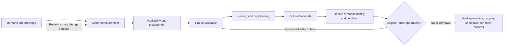
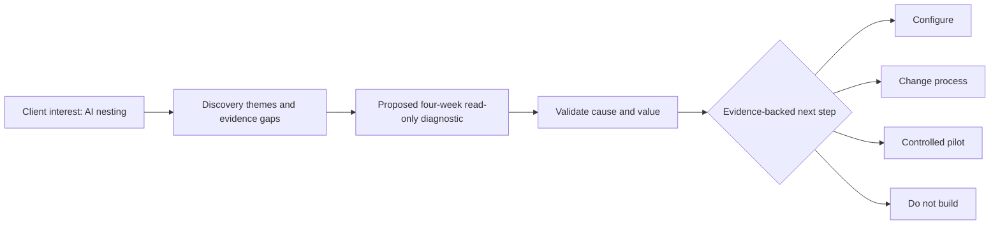

# 02 — Problem and process

## Case framing

The stated starting interest is AI-powered nesting optimisation. The supplied discovery themes also include material yield and waste, remnants/offcuts, drawing revisions, project allocation, yard accessibility, and existing STRUMIS capabilities. Treat these as **user-provided case context**, not verified observations in this repository. No process map has been validated with the client.

## Working process to validate

The following is a discovery hypothesis about common material decision points, not a confirmed client workflow:

The case-level decision path is separate from this hypothesized shop-floor flow:

## Why nesting cannot be presumed to be the cause

Material yield may be affected by demand and drawing changes, stock dimensions, cut plans, remnant capture, inventory accuracy, yard access, allocation rules, traceability, certification, and planner behavior. A nesting optimizer addresses only some parts of that system. Without a baseline and validated cause, optimizing the cut layout could leave the dominant constraint untouched or increase operational complexity.

## Known, unknown, and hypothetical

| Category | Current statement |
|---|---|
| **User-provided** | There is an interest in AI nesting; listed discovery themes may include waste/yield, remnants, revisions, allocation, yard access, and STRUMIS. |
| **Unknown** | Actual process steps, systems of record, data quality, waste quantities, remnant volumes, loss causes, transfer rules, and potential value. |
| **Hypothesis** | Some remnant reuse decisions may be blocked by visibility, identity, availability, permissions, or process controls. |
| **Not established** | That nesting is the main loss source, reuse is feasible at scale, or software would improve outcomes. |

The [assumptions register](../analysis/assumptions-register.md) lists validation methods and implications if assumptions fail. The diagnostic recommendation is to [measure before selecting an intervention](03-diagnostic-methodology.md).
