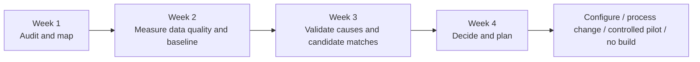
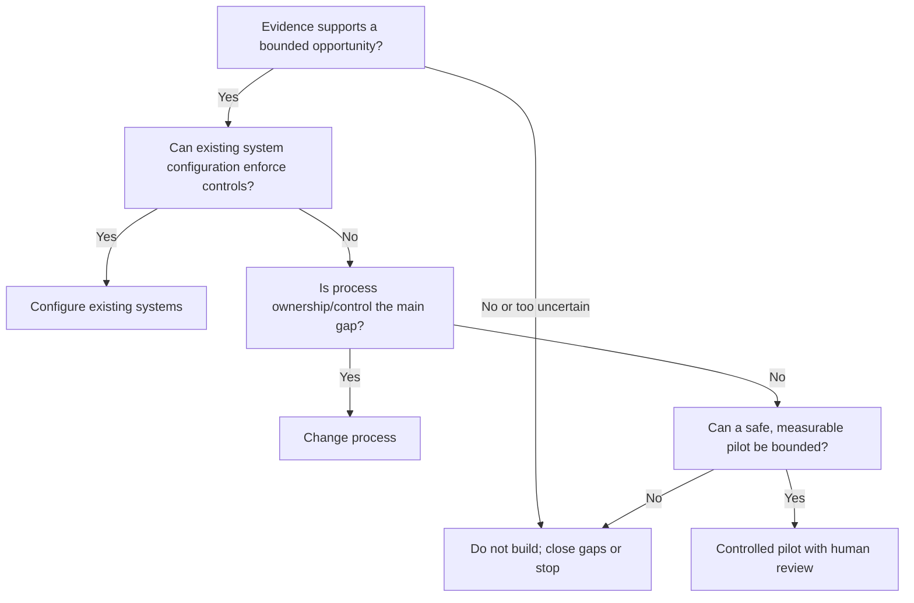

# 03 — Proposed four-week diagnostic

> **Proposed, not completed.** This is a read-only diagnostic recommendation. It does not authorize access to systems or data; scope, access, retention, and participants must be agreed with the client.

## Timeline

## Work plan

| Week | Work | Evidence and output |
|---|---|---|
| **1 — Audit** | Align scope and constraints; map material demand, procurement, nesting/cutting, remnant disposition, revision handling, allocation, and yard access with relevant stakeholders. | Agreed workflow, owner map, system boundaries, evidence request, and unknowns. |
| **2 — Measure** | Inspect only approved, minimum-necessary records; profile identifiers, units, completeness, status meanings, and links across jobs, stock, remnants, and certificates. Establish a baseline only if reliable evidence supports it. | Data-quality profile, coverage statement, candidate denominators and baseline with caveats. |
| **3 — Validate** | Review candidate matches and exceptions with planning, stores, engineering, quality, production, and system owners as appropriate. Compare matched jobs and backtest remnant-reuse rules where historical links are trustworthy. | Validated rule candidates, reason codes, failure modes, and evidence-backed hypotheses. |
| **4 — Decide** | Assess operational value, feasibility, controls, and adoption; propose a safe next step and evaluation design. | Decision memo and build/configure/process-change/pilot/stop recommendation. |

## Data and people to consider

Potential approved inputs include demand/requirement records, material grade and dimensions, stock/remnant identity, availability and reservation state, project ownership and transfer policy, certification/traceability references, drawing revisions, cut/nesting plans, consumption, and disposition. This is a discovery checklist, not a claim that these fields exist or will be accessible.

Potential participants include planners, procurement, stores/yard, production, engineering, quality, IT/system owners, and accountable operational leadership. Confirm roles with the client rather than assuming an organization chart.

## Baseline and backtesting

Agree population, time window, units, denominators, exclusions, authoritative sources, and missing/conflicting-value treatment before calculation. A baseline should state data coverage, unresolved identity/status records, and whether quantities are based on stock issue, cut plans, or actual consumption.

Matched-job benchmarking should define comparable jobs before comparison (for example, material family, geometry mix, and production context), state why jobs are comparable, and account for differences that may affect yield. Report selection effects and uncertainty; do not attribute any observed difference to nesting without evidence.

Remnant-reuse backtesting should apply reviewed rules to historical requirements and remnants with known provenance, availability, transfer rights, and certification evidence. Record eligible/rejected/review outcomes and reason codes, then have qualified reviewers adjudicate a representative sample. Historical availability and project permissions can change, so reconstructed outcomes need time-aware validation. Do not infer savings without a validated counterfactual and cost basis.

## Decision gate

All paths remain subject to client decision and qualified safety/quality review. No production development is presumed. See [evaluation criteria](06-evaluation-and-limitations.md).
