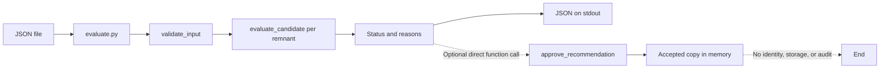
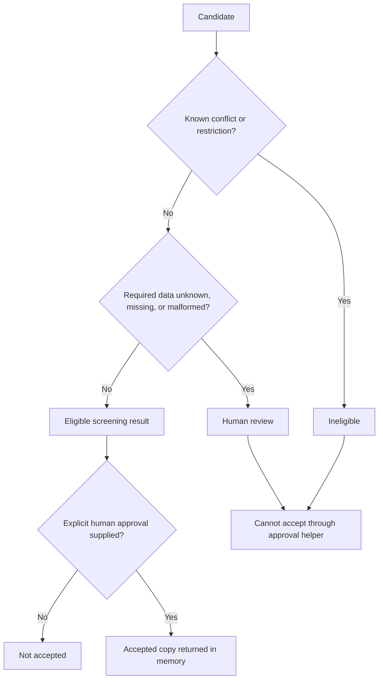
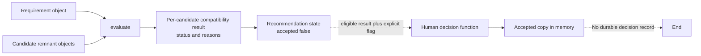

# 05 — System design

## Implemented components

| Component | Responsibility |
|---|---|
| `prototype/src/evaluate.py` | Reads one JSON file, calls the evaluator, emits JSON to stdout, and reports file/JSON/validation errors to stderr with exit code 2. |
| `prototype/src/decision.py::validate_input` | Validates object/list shape, all required requirement fields, positive finite dimensions, and candidate object IDs. |
| `prototype/src/decision.py::evaluate_candidate` | Applies deterministic checks and returns a status, reason list, and `accepted: false`. |
| `prototype/src/decision.py::approve_recommendation` | Returns an accepted copy only when explicitly passed `human_approved=True` and status is eligible. It is not called by the CLI and has no persistence or identity controls. |
| `prototype/tests/` | Exercises rule outcomes, approval boundaries, ownership restrictions, and the documented CLI workflow. |
| `prototype/data/example_case.json` | Synthetic input fixture. |

## Compatibility checks

## Demonstration data model

The arrows describe function inputs and returned values, not stored database relationships. No reviewer entity or persistent human-decision record exists in the implementation.

Rules currently implemented:

1. Grade matches as trimmed, case-insensitive exact strings; no equivalency table exists.
2. Thickness must match as an exact number. Length/width must fit the rectangular requirement, allowing a 90-degree rotation; kerf and tolerances are ignored.
3. `available: false` rejects. Missing/non-boolean availability requires review.
4. `restricted` transfer rejects. `unknown` or malformed transfer permission requires review. `same_project` requires matching non-empty project IDs. `allowed` is an input assertion that permits cross-project transfer but still requires non-empty source project identity.
5. Missing/invalid grade or dimensions requires review. Only exact certification status `verified` passes this demo gate; no certificate is checked.
6. Known incompatibility takes precedence over review status, so a candidate with a known rejection reason is `ineligible` even if other fields are unknown.

## Input validation and error behavior

Malformed top-level input, missing requirement fields, non-positive/non-finite dimensions, malformed candidate records, or missing candidate IDs cause `ValueError`; the CLI turns this into an input error and exits with code 2. Candidate screening attributes are handled conservatively and surfaced as review reasons. Extra JSON keys are currently ignored.

## Evidence boundary

The decision `reasons` list is an explanation returned in memory and printed by the CLI. It is not an audit log. Approval has no authenticated actor, timestamp, persistence, or linkage to a stock reservation. The prototype does not connect to STRUMIS or another system, and uses no LLM for technical decisions.

## Security and operations

There is no network service, credential handling, database, role-based access, concurrency control, monitoring, retention policy, or deployment configuration. File access is local to the CLI. These omissions are acceptable only for a synthetic demonstration, not an operational pilot. See [limitations and future evaluation](06-evaluation-and-limitations.md).
